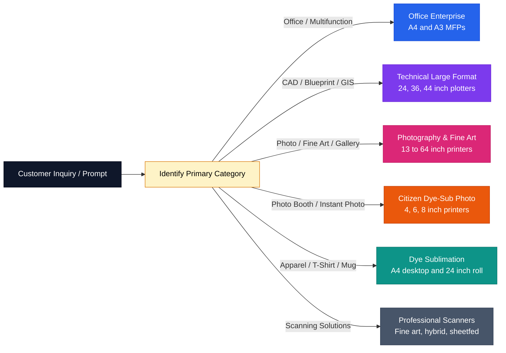
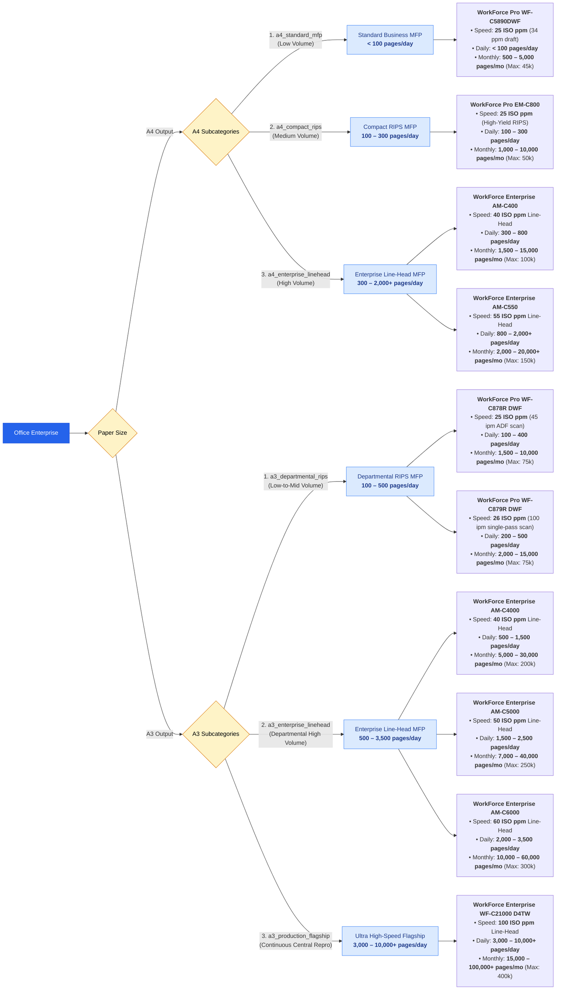
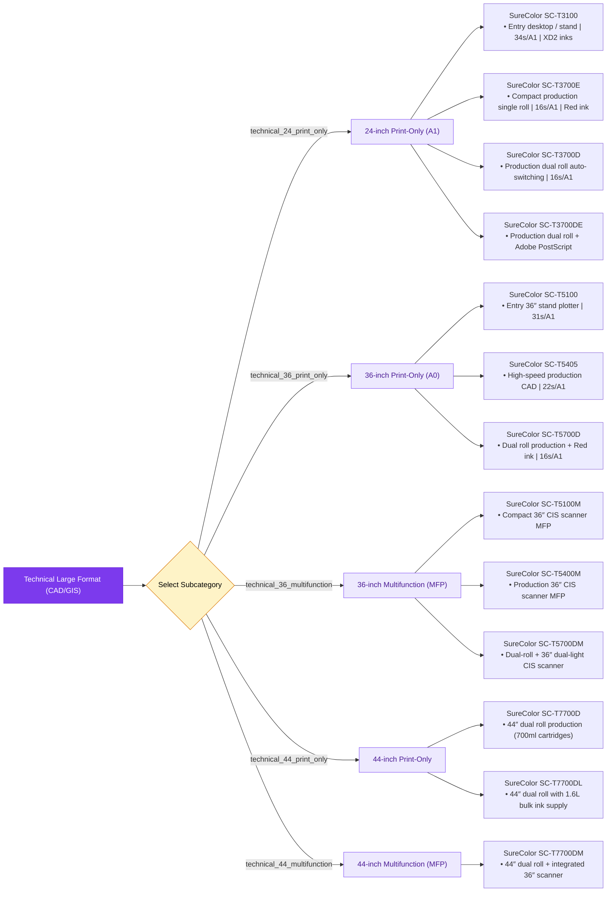
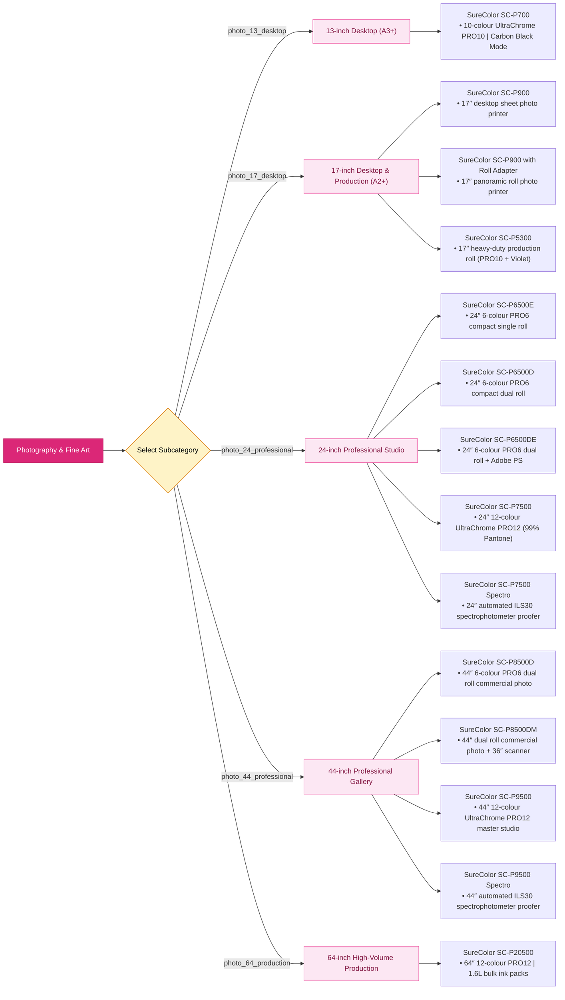
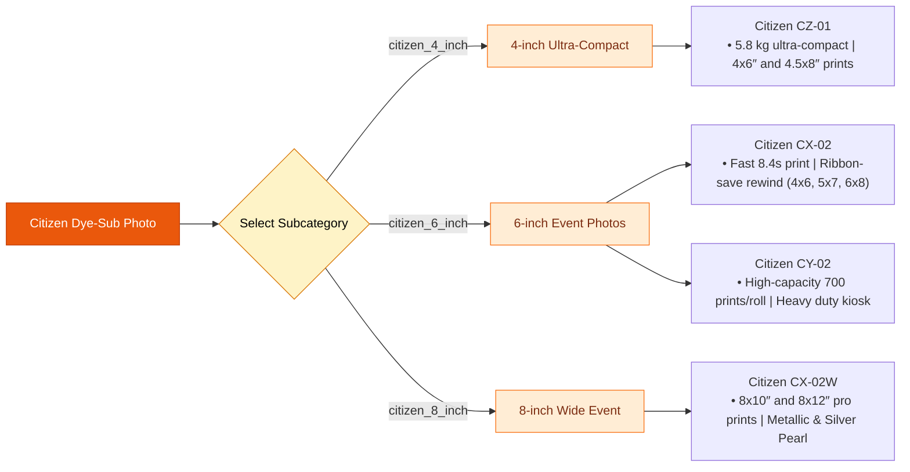
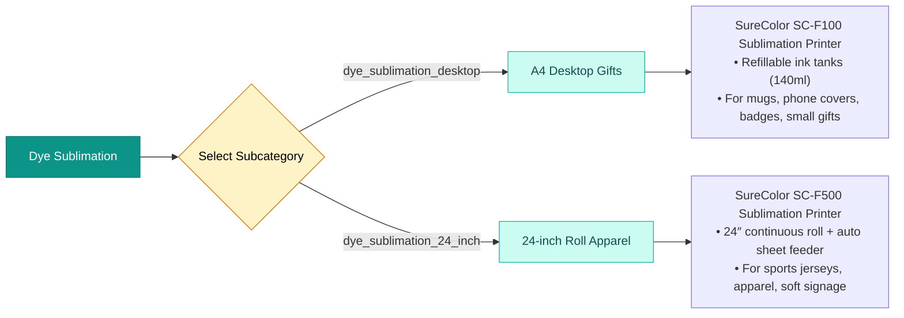
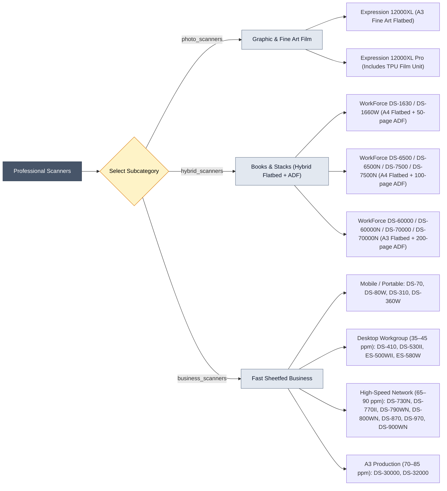

# Kepler Tech SalesAI — Complete Product Qualification & Category Workflows

This document contains the complete qualification flows, decision trees, and deterministic subcategory mappings for all **43 certified hardware printers** and **29 professional scanners** in the Kepler Tech catalogue.

---

## 1. Product Qualification Flowchart: Overview

---

## 2. Office / Multifunction (3 Subcategories in A4 & 3 Subcategories in A3)

### Office Volume & Speed Calculation Reference

| Format | Subcategory | Model | Speed | Daily Pages | Recommended Monthly Volume | Max Monthly Duty |
| :--- | :--- | :--- | :---: | :---: | :---: | :---: |
| **A4** | `a4_standard_mfp` | **WF-C5890DWF** | 25 ppm | < 100 pages | 500 – 5,000 | 45,000 |
| **A4** | `a4_compact_rips` | **EM-C800** | 25 ppm | 100 – 300 pages | 1,000 – 10,000 | 50,000 |
| **A4** | `a4_enterprise_linehead` | **AM-C400** | 40 ppm | 300 – 800 pages | 1,500 – 15,000 | 100,000 |
| **A4** | `a4_enterprise_linehead` | **AM-C550** | 55 ppm | 800 – 2,000 pages | 2,000 – 20,000+ | 150,000 |
| **A3** | `a3_departmental_rips` | **WF-C878R DWF** | 25 ppm | 100 – 400 pages | 1,500 – 10,000 | 75,000 |
| **A3** | `a3_departmental_rips` | **WF-C879R DWF** | 26 ppm | 200 – 500 pages | 2,000 – 15,000 | 75,000 |
| **A3** | `a3_enterprise_linehead` | **AM-C4000** | 40 ppm | 500 – 1,500 pages | 5,000 – 30,000 | 200,000 |
| **A3** | `a3_enterprise_linehead` | **AM-C5000** | 50 ppm | 1,500 – 2,500 pages | 7,000 – 40,000 | 250,000 |
| **A3** | `a3_enterprise_linehead` | **AM-C6000** | 60 ppm | 2,000 – 3,500 pages | 10,000 – 60,000 | 300,000 |
| **A3** | `a3_production_flagship` | **WF-C21000 D4TW** | 100 ppm | 3,000 – 10,000+ pages | 15,000 – 100,000+ | 400,000 |

---

## 3. CAD / Technical Large Format (`technical_large_format` — All 13 Models)

---

## 4. Photography & Fine Art (`photography_large_format` — All 14 Models)

---

## 5. Photo Booth / Instant Photo (`citizen_photo` — All 4 Models)

---

## 6. Apparel / T-Shirt / Mug (`dye_sublimation` — All 2 Models)

---

## 7. Scanning Solutions (`scanners` — All 29 Models)

